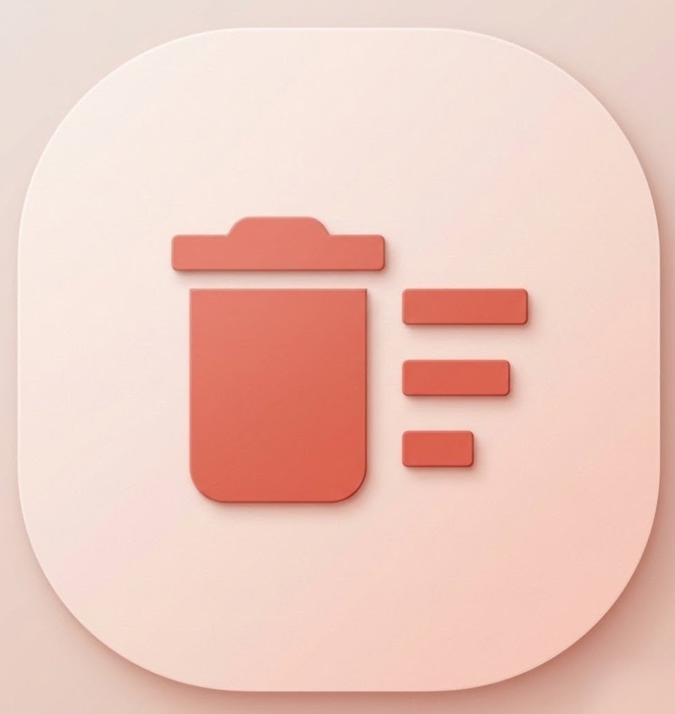
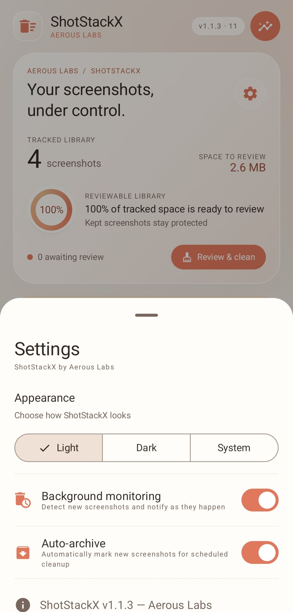
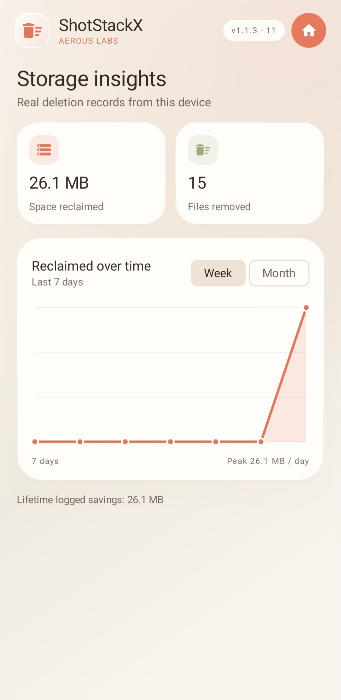
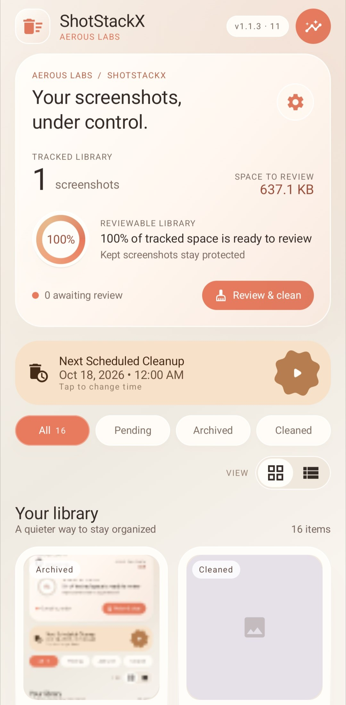

<div align="center">
  
  <h1>ShotStackX</h1>
  <p>Aerous Labs — the flagship screenshot cleanup utility</p>
  <p>
    <strong>Kotlin</strong> · <strong>Jetpack Compose</strong> · <strong>Material 3</strong>
  </p>
  <p>
    <a href="#install">Install</a> ·
    <a href="#features">Features</a> ·
    <a href="#tech-stack">Tech Stack</a> ·
    <a href="#getting-started">Getting Started</a> ·
    <a href="#permissions">Permissions</a>
  </p>
</div>

---

ShotStackX monitors newly created screenshots, lets you archive or delete them through lightweight notifications, and automatically cleans up unarchived screenshots on a schedule. Intentionally lightweight, battery-friendly, and aligned with modern Android storage and background execution policies.

## Install

<p align="center">
  <a href="https://github.com/aerouslabs-dev/ShotStackX/releases/latest">
    
  </a>
  <a href="https://apps.obtainium.imranr.dev/redirect?r=obtainium://app/%7B%22id%22%3A%22com.aerouslabs.shotstackx%22%2C%22url%22%3A%22https%3A%2F%2Fgithub.com%2Faerouslabs-dev%2FShotStackX%22%2C%22author%22%3A%22Aerous%20Labs%22%2C%22name%22%3A%22ShotStackX%22%2C%22preferredApkIndex%22%3A0%2C%22additionalSettings%22%3A%22%7B%5C%22includePrereleases%5C%22%3Atrue%2C%5C%22fallbackToOlderReleases%5C%22%3Atrue%7D%22%2C%22overrideSource%22%3Anull%7D">
    
  </a>
  <a href="https://apt.izzysoft.org/fdroid/apk/com.aerouslabs.shotstackx">
    
  </a>
  <a href="https://f-droid.org/packages/com.aerouslabs.shotstackx/">
    
  </a>
  <a href="LICENSE">
    
  </a>
</p>

## Screenshots

<table align="center">
  <tr>
    <td></td>
    <td></td>
    <td></td>
  </tr>
  <tr>
    <td></td>
    <td></td>
    <td></td>
  </tr>
</table>

## Features

- **Screenshot Detection** — URI-based detection via MediaStore `ContentObserver` with cold-start initial scan, exponential-backoff retry, `IS_PENDING` column filtering, and fallback scan for edge cases.
- **Action Notifications** — Archive, Keep, or Delete directly from a dismissible notification.
- **Auto-Archive Mode** — Long-press the Archived card to auto-archive every new screenshot by default.
- **Battery Optimization Opt-Out** — Dedicated card with a one-tap "Battery Usage" button to disable battery optimization.
- **Automatic Cleanup** — WorkManager-based daily cleanup removes archived screenshots.

## Tech Stack

| Layer            | Technology                  |
| ---------------- | --------------------------- |
| Language         | Kotlin                      |
| UI               | Jetpack Compose + Material 3|
| Local Database   | Room                        |
| Background Tasks | WorkManager                 |
| Storage APIs     | MediaStore                  |
| Notifications    | NotificationCompat          |
| Architecture     | MVVM-lite                   |

## Getting Started

1. Open the project in **Android Studio**.
2. Sync Gradle (uses version catalog at `gradle/libs.versions.toml`).
3. Build and run on a device running **Android 14+** (min SDK 34).

> No API keys, no cloud services, no configuration required.

## Building from Source

```bash
# Clone the repository
git clone https://github.com/aerouslabs-dev/ShotStackX.git
cd ShotStackX

# Build debug APK
./gradlew assembleDebug

# Build release APK
./gradlew assembleRelease

# Run unit tests
./gradlew test

# Run lint checks
./gradlew lint
```

## Permissions

| Permission | Purpose |
| :--- | :--- |
| `READ_MEDIA_IMAGES` | Required to query screenshots from MediaStore. |
| `POST_NOTIFICATIONS` | Required for screenshot action notifications. |
| `MANAGE_EXTERNAL_STORAGE` | Required for batch deletion of archived screenshots. |
| `REQUEST_IGNORE_BATTERY_OPTIMIZATIONS` | Required to opt out of battery optimization for reliable background detection. |

Project Structure
app/src/main/java/com/aerouslabs/shotstackx/
├── core/              — Constants, extensions, utils
├── data/              — Room DB, DAO, entities, repositories
├── notifications/     — Notification manager & action receiver
├── observer/          — ContentObserver & screenshot detection
├── ui/                — Compose screens, components, theme
├── viewmodel/         — ViewModels
├── worker/            — WorkManager cleanup worker
├── MainActivity.kt
└── ShotStackXApp.kt

## Documentation

## Documentation

| Document | Description |
| --- | --- |
| [Architecture](docs/architecture.md) | MVVM layers, process flows, component details |
| [Features](docs/features.md) | Detailed feature descriptions |
| [Database Schema](docs/database.md) | Room entities, DAO, repository |
| [Notifications](docs/notifications.md) | Notification flow & action handling |
| [Cleanup Worker](docs/cleanup-worker.md) | WorkManager-based cleanup pipeline |
| [Resource Usage](docs/resource-usage.md) | Foreground / background CPU, memory, and battery profiling |
| [Performance Profile](docs/PROD_RELEASE_PROFILING.md) | Empirical production release profiling & benchmarks (Perfetto, ADB, dumpsys, AOT) |
| [Development](docs/development.md) | Principles, design goals, MVP scope, future ideas |
| [Release Signing](docs/release-signing.md) | Keystore setup, CI signing, troubleshooting |
| [Changelog](CHANGELOG.md) | Release history |

## License

This project is licensed under the **MIT License** — see the [LICENSE](LICENSE) file for details.

## Contributing

Contributions are welcome! Please feel free to submit a Pull Request. For major changes, please open an issue first to discuss what you would like to change.
